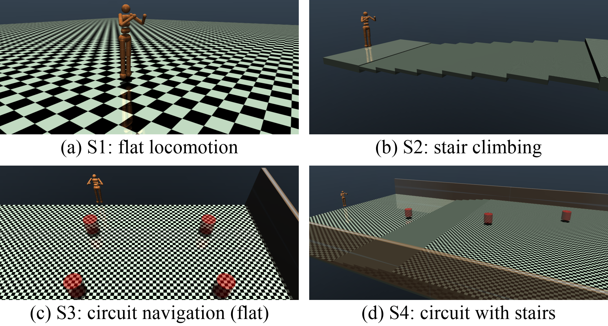
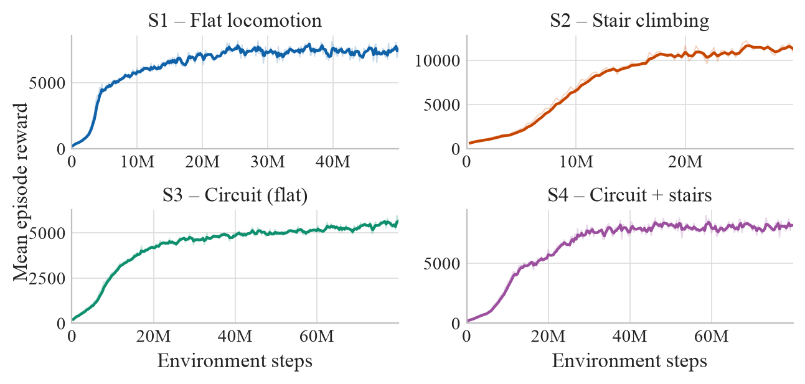

# Reward Shaping and Terrain-Relative Termination for PPO Humanoid Locomotion Beyond Flat Ground

**João Viterbo Vieira · Francisco Pinto · José Pedro Carvalho · António Pedro Aguiar**
Faculty of Engineering, University of Porto (FEUP) · SYSTEC-ARISE

Official code, trained models and evaluation scripts for our **ROBOT2026** paper.

📄 [**Paper (PDF)**](paper/RL_Humanoid_conference.pdf) · 🎞️ [**Slides**](ROBOT2026_presentation/paper%20robot2026.pdf) · 🎬 [**Videos**](best_videos/)



---

## Description

Standard PPO reliably teaches the MuJoCo Humanoid to walk on flat ground, but the same recipe often fails on stairs and long-horizon navigation. This repository is an empirical case study showing that the causes are frequently **implementation-level rather than algorithmic**. We isolate two design choices:

1. **Reward alignment.** Forward-velocity rewards do not describe progress on stairs. Adding height-progress and step-milestone terms makes stair climbing the most reliably solved task, with the smallest training budget.
2. **Episode-termination logic.** The usual "healthy" check bounds the torso height in a fixed world frame, which terminates episodes of perfectly healthy agents as soon as they stand on elevated terrain. Measuring the height **relative to the terrain under the agent** (`z_rel = z − h(x, y)`) was the single change that made the combined circuit-with-stairs task learnable.

The repository contains two custom, fully parameterized Gymnasium/MuJoCo environments (configurable stairs and waypoint circuits with optional stair segments), the Hydra training configurations, the four trained policies reported in the paper, and the scripts that reproduce every number in it.

## Results

All policies are trained with PPO (Stable-Baselines3), one training seed (42) per task, and evaluated for 100 episodes with a held-out evaluation seed and a deterministic policy.

| Task | Environment | Train steps | Reward | Success | 5-seed sweep |
|------|-------------|-------------|--------|---------|--------------|
| **S1** Flat locomotion | `Humanoid-v5` | 50M | 8,429 ± 2,320 | 84% | 80 ± 5% |
| **S2** Stair climbing | `HumanoidStairsConfigurable-v0` | 30M | 15,760 ± 1,868 | **96%** | 92 ± 3% |
| **S3** Circuit (flat) | `HumanoidCircuit-v0` | 80M | 6,949 ± 1,537 | 47% | 54 ± 5% |
| **S4** Circuit + stairs | `HumanoidCircuit-v0` | 80M | 10,134 ± 2,421 | **87%** | 81 ± 5% |

Success is task-defined: no fall over the full 1000-step horizon (S1), reaching the top step (S2), reaching all waypoints (S3/S4). The sweep column is the mean ± s.d. of the success rate over five additional evaluation seeds (0–4).

**Termination matters.** Under fixed world-frame health bounds, none of nine development runs (~520M steps) learned to traverse the stair segment of S4; with the terrain-relative check it reaches 87% completion. An evaluation-time ablation confirms the mechanism: on S2, the world-frame check cuts the mean episode length from 960 to 645 steps, and every one of those terminations happens while the agent is standing upright on the elevated platform.



Videos of the four policies are in [`best_videos/`](best_videos/).

---

## Installation

Requires Python 3.10+.

```bash
git clone https://github.com/joao-viterbo-vieira/RL-Humanoid.git
cd RL-Humanoid

python -m venv .venv
source .venv/bin/activate        # Windows: .\.venv\Scripts\activate

pip install -r requirements.txt
```

If MuJoCo rendering fails on Linux/macOS, set `export MUJOCO_GL=glfw`.

## Reproducing the paper

The four reported checkpoints are tracked in [`outputs_best/`](outputs_best/) (model, normalization statistics, training log and Hydra config for each run), so every table can be regenerated without retraining.

| Task | Run directory | Training config |
|------|---------------|-----------------|
| S1 | `outputs_best/2025-10-28/17-47-25` | `env=humanoid` |
| S2 | `outputs_best/2025-12-06/17-36-50` | `env=humanoid_stairs_easy` |
| S3 | `outputs_best/2025-12-23/14-37-50` | `env=humanoid_circuit_flat` |
| S4 | `outputs_best/2025-12-24/16-29-37` | `env=humanoid_circuit_easy` |

**Success rates (Table IV).** Each environment is rebuilt from the run's own `.hydra/config.yaml`, so the policies are evaluated on exactly the geometry and rewards they were trained on:

```bash
python scripts/evaluate/evaluate_paper_stats.py --episodes 100 --seed 123
python scripts/evaluate/evaluate_paper_stats.py --only S2,S4      # subset of tasks
```

**Five-seed robustness sweep** (results in `outputs_best/multiseed/`):

```bash
scripts/evaluate/run_multiseed.sh
```

**Termination ablation (Table V)** — terrain-relative vs. world-frame health check on the trained S2 and S4 policies (results in `outputs_best/termination_ablation.json`):

```bash
python scripts/evaluate/evaluate_termination_ablation.py --episodes 100 --seed 123
```

**Training curves (Fig. 3)** — needs `pandas` and `matplotlib` in addition to `requirements.txt`:

```bash
python scripts/plot_training_curves.py --outdir figures
```

**Watch a policy.** [`how_to_use.txt`](how_to_use.txt) lists the exact render commands, including the `--env_kwargs` of each task. Its model paths start with `outputs/`; either replace that prefix with `outputs_best/` or copy the runs over with `cp -r outputs_best/* outputs/`. For example, the stair-climbing policy:

```bash
python scripts/evaluate/evaluate_sb3.py \
  --env_id HumanoidStairsConfigurable-v0 \
  --model_path outputs_best/2025-12-06/17-36-50/eval/best_model.zip \
  --vecnorm_path outputs_best/2025-12-06/17-36-50/vecnormalize_final.pkl \
  --render --deterministic --episodes 5 \
  --env_kwargs '{"flat_distance_before_stairs": 2.0, "num_steps": 8, "step_height": 0.1, "step_depth": 0.8, "end_platform_length": 5.0, "stairs_after_top": false, "end_with_abyss": false, "forward_reward_weight": 2.0, "height_reward_weight": 8.0, "ctrl_cost_weight": 0.1, "contact_cost_weight": 2e-07, "healthy_reward": 15.0, "step_bonus": 5.0, "lateral_penalty_weight": 0.3, "check_healthy_z_relative": true, "terminate_when_unhealthy": true, "healthy_z_range": [1.0, 2.0]}'
```

On Windows PowerShell, wrap the JSON in single quotes and escape the inner double quotes (`\"`).

## Training from scratch

Training uses Hydra; any parameter can be overridden on the command line. Outputs go to `outputs/<date>/<time>/`.

```bash
# S1 — flat locomotion
python scripts/train/train_sb3.py env=humanoid training.total_timesteps=50000000

# S2 — stair climbing (8 steps, 0.10 m rise, terrain-relative termination)
python scripts/train/train_sb3.py env=humanoid_stairs_easy training.total_timesteps=30000000

# S3 — flat circuit (4 waypoints, 3 turns)
python scripts/train/train_sb3.py env=humanoid_circuit_flat training.total_timesteps=80000000

# S4 — circuit with a 5-step stair segment (terrain-relative termination)
python scripts/train/train_sb3.py env=humanoid_circuit_easy training.total_timesteps=80000000
```

Useful overrides and tools:

```bash
# Resume a run (restores the model and the VecNormalize statistics)
python scripts/train/train_sb3.py env=humanoid_stairs_easy \
  resume_from="outputs/<date>/<time>/checkpoints/model_750000.zip"

# More parallel environments, different learning rate
python scripts/train/train_sb3.py env=humanoid env.vec_env.n_envs=32 \
  algo.hyperparams.learning_rate=2.5e-4

# Monitor training
tensorboard --logdir outputs
```

## Environments

| Environment | Obs. dims | Description |
|-------------|-----------|-------------|
| `Humanoid-v5` | 348 | Gymnasium flat-ground baseline |
| `HumanoidStairsConfigurable-v0` | 401 | Staircase with configurable approach distance, step count, step height/depth and top platform |
| `HumanoidCircuit-v0` | 406 | Ordered waypoints in a walled corridor, with optional stair segments |
| `HumanoidStairs-v0` | 401 | Original fixed 10-step staircase |
| `HumanoidDestination-v0` | 378 | Walk to a target position (not used in the paper) |

- **Action space:** 17 joint torques, bounded in `[-0.4, 0.4]`, at a 66.7 Hz control rate.
- **Terrain grid (+25):** 5×5 height samples around the agent at 0.3 m spacing, relative to the torso height.
- **Waypoint features (+5):** displacement to the active waypoint (2), fraction of waypoints completed (1), heading error as sin/cos (2).
- **Terrain-relative termination:** enabled with `check_healthy_z_relative: true` in the environment config.

More stair and circuit variants (`humanoid_stairs_hard`, `humanoid_stairs_updown`, `humanoid_circuit_complex`, …) are available in [`conf/env/`](conf/env/). See [`envs/README.md`](envs/README.md) for details.

## Repository structure

```
RL-Humanoid/
├── paper/                    # ROBOT2026 paper (PDF)
├── ROBOT2026_presentation/   # Conference slides (PDF and PPTX)
├── envs/                     # Custom Gymnasium/MuJoCo environments
│   ├── custom/               #   stairs, configurable stairs, circuit, destination
│   └── assets/               #   MuJoCo XML models
├── conf/                     # Hydra configuration
│   ├── main.yaml             #   global settings (seed, VecNormalize, resume)
│   ├── env/                  #   one file per task variant
│   ├── algo/                 #   PPO (main), SAC (experimental)
│   └── training/             #   training budgets
├── scripts/
│   ├── train/                # train_sb3.py (main), SAC and TorchRL variants
│   ├── evaluate/             # paper statistics, ablation, rendering, videos
│   ├── utils/                # debugging and visualization helpers
│   └── plot_training_curves.py
├── utils/                    # env factory, callbacks, reward wrappers
├── outputs_best/             # The four reported runs and evaluation results
├── best_videos/              # Videos of the four policies
├── figures/, images/         # Paper figures
├── docs/                     # Design notes, reward analysis, training log
├── how_to_use.txt            # Exact train/eval commands for the four runs
└── requirements.txt
```

## Documentation

- [Scripts reference](scripts/SCRIPTS_REFERENCE.md) — every training, evaluation and utility script
- [Environments](envs/README.md) and [observation spaces](docs/OBSERVATION_SPACES.md)
- [Reward functions analysis](docs/REWARD_FUNCTIONS_ANALYSIS.md)
- [Configurable stairs](docs/CONFIGURABLE_STAIRS.md) and [circuit environment](docs/CIRCUIT_ENVIRONMENT.md)
- [Training log](docs/TRAINING_LOG.md) — the 58 development runs (~2.6B environment steps) behind the paper

The SAC and TorchRL scripts (`train_sac.py`, `train_torchrl.py`) are experimental and not part of the reported results.

## Limitations

All final results come from a single training seed per task; the five-seed sweep measures evaluation noise only, not training-seed variance. The numbers should be read as a documented case study rather than population estimates. The terrain height grid is privileged simulator information, and no sim-to-real transfer is attempted.

## Citation

If you use this code or the environments, please cite:

```bibtex
@inproceedings{vieira2026humanoid,
  title     = {Reward Shaping and Terrain-Relative Termination for {PPO} Humanoid Locomotion Beyond Flat Ground},
  author    = {Vieira, Jo{\~a}o Viterbo and Pinto, Francisco and Carvalho, Jos{\'e} Pedro and Aguiar, Ant{\'o}nio Pedro},
  booktitle = {ROBOT2026: Iberian Robotics Conference},
  year      = {2026}
}
```

## Acknowledgments

Built on [Gymnasium](https://gymnasium.farama.org/), [MuJoCo](https://mujoco.org/), [Stable-Baselines3](https://stable-baselines3.readthedocs.io/) and [Hydra](https://hydra.cc/).
